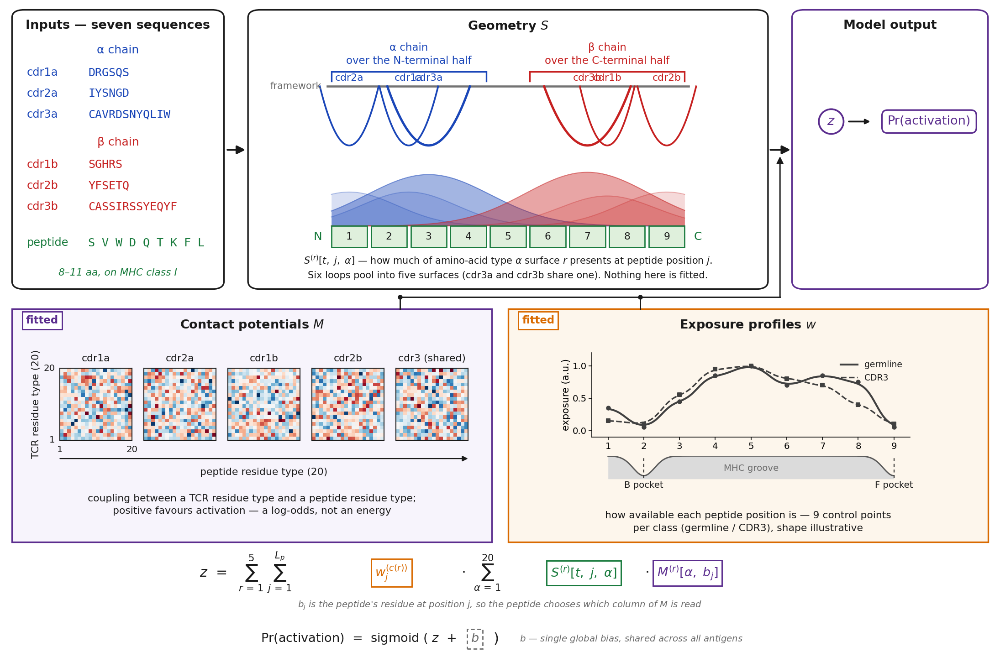

# TACO

**An open, interpretable model for microsecond-scale TCR specificity prediction**

TACO (T-Cell Activation from Chemistry and Orientation) is an open statistical model for predicting TCR specificity against HLA-A\*02:01-presented peptides. It takes as input the peptide sequence and six TCR CDR loop sequences, selects a canonical orientation of the CDR loops over the peptide, and learns amino-acid contact-potential matrices and peptide-exposure profiles from binary activation labels. No experimentally determined or predicted structures are required.

The model has 2,019 fitted parameters and reaches 406,000 TCR-peptide predictions per second on CPU.

## Repository contents

| File | Description |
|------|-------------|
| `taco_model.py` | Model implementation |
| `TACO_training.ipynb` | Training notebook |
| `TACO_evaluations.ipynb` | Evaluation and benchmarking |
| `TACO_demo.ipynb` | Quick-start demo |
| `TACO_viral_peptide_screening.ipynb` | Viral peptide screening application |
| `data/taco/` | Model parameters |

## Getting started

Open `TACO_demo.ipynb` for a quick walkthrough of loading the model and running predictions.

## Citation

If you use TACO in your work, please cite:

> Garcia Noceda, M., Calfee, E., Zhang, B.C., Osborne, E., Greenfield, B., Klinger, M., Noakes, M.T., Howie, B., & Robins, H. *TACO: An Open, Interpretable Model for Microsecond-Scale TCR Specificity Prediction.* (Manuscript submitted.)

A BibTeX entry will be provided once the paper is published.

## Related

TACO was created at [Adaptive Biotechnologies](https://www.adaptivebiotech.com/). For additional models and curated immunomics datasets, visit [Harell Data](https://harelldata.com/).
