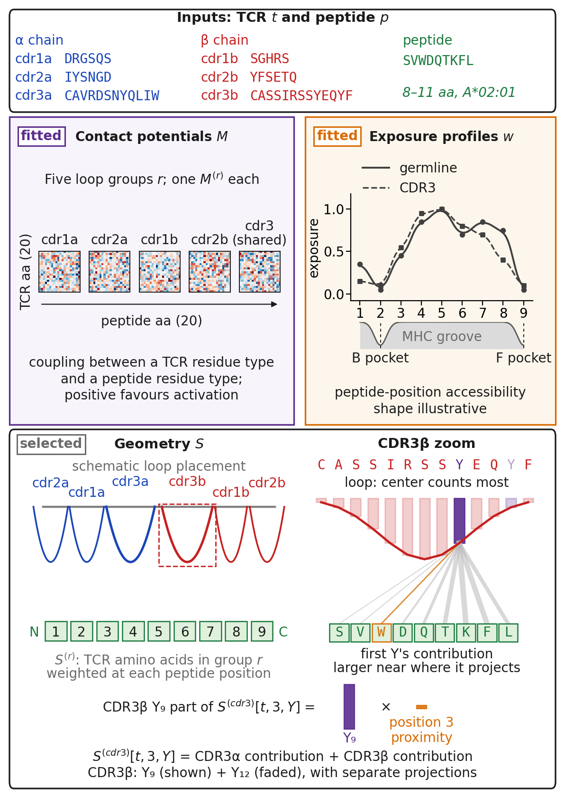

# TACO

**An open, interpretable model for microsecond-scale TCR specificity prediction**

TACO (T-Cell Activation from Chemistry and Orientation) is an open statistical model for predicting TCR specificity against HLA-A\*02:01-presented peptides. It takes as input the peptide sequence and six TCR CDR loop sequences, selects a canonical orientation of the CDR loops over the peptide, and learns amino-acid contact-potential matrices and peptide-exposure profiles from binary activation labels. No experimentally determined or predicted structures are required.

The model has 2,019 fitted parameters and reaches 406,000 TCR-peptide predictions per second on CPU.

## Repository contents

| File | Description |
|------|-------------|
| `taco_model.py` | Model implementation |
| `TACO_training.ipynb` | Training notebook |
| `TACO_evaluations.ipynb` | Evaluation and benchmarking |
| `TACO_demo.ipynb` | Quick-start demo |
| `TACO_viral_peptide_screening.ipynb` | Viral peptide screening application |
| `data/taco/` | Model parameters |

## Getting started

Open `TACO_demo.ipynb` for a quick walkthrough of loading the model and running predictions.

The notebooks may prompt you to select a kernel -- chose any Python 3 environment you have available.

## Citation

If you use TACO in your work, please cite:

> Garcia Noceda, M., Calfee, E., Zhang, B.C., Osborne, E., Greenfield, B., Klinger, M., Noakes, M.T., Howie, B., & Robins, H. *TACO: An Open, Interpretable Model for Microsecond-Scale TCR Specificity Prediction.* (Manuscript submitted.)

A BibTeX entry will be provided once the paper is published.

## License

TACO source code is licensed under the Apache License, Version 2.0 (see the LICENSE file in this repository).

### Model Weights Terms of Use

Trained model weights are being made available with this repository solely for research purposes. The model weights may not be used, directly or indirectly, for commercial development or commercialization of any product or service without prior written permission from Adaptive Biotechnologies, Corp.

### Data and code availability

The trained model weights provided here were learned using proprietary datasets. As a result, these weights cannot be exactly re-fit using the training code provided here.

### Intellectual Property Notice

Copyright &copy; 2026 Adaptive Biotechnologies Corp. The availability of this source code should not be interpreted as a dedication to the public, disclosure, waiver, or license of any intellectual property rights other than the specific rights expressly granted under the applicable software license. Any descriptions, examples, test data, workflows, or documentation included in this repository are provided solely to support use of the software as permitted by the applicable license and should not be construed as granting any additional rights. The code, data, documentation, and other materials made available through this repository are intended solely for research uses as permitted under the licenses in this repository. They may not be used, directly or indirectly, to develop, validate, support, market, sell, license, or commercialize any product or service without prior written permission from Adaptive Biotechnologies, Corp.

### Questions

For questions about the methods or manuscript, please contact the corresponding author(s) listed in the preprint.

## Related

TACO was created at [Adaptive Biotechnologies](https://www.adaptivebiotech.com/). For additional models and curated immunomics datasets, visit [Harell Data](https://harelldata.com/).
